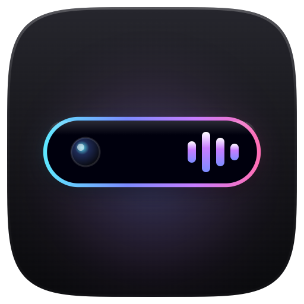
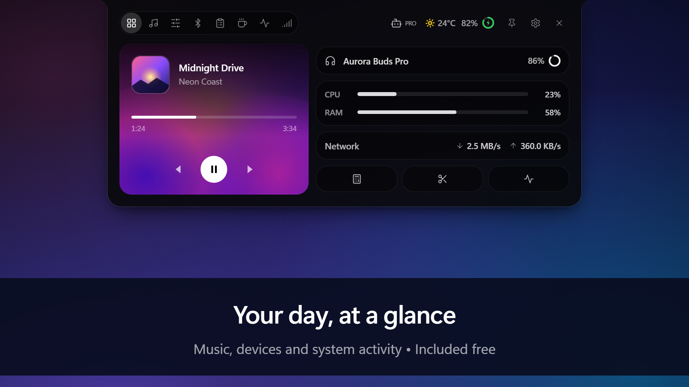
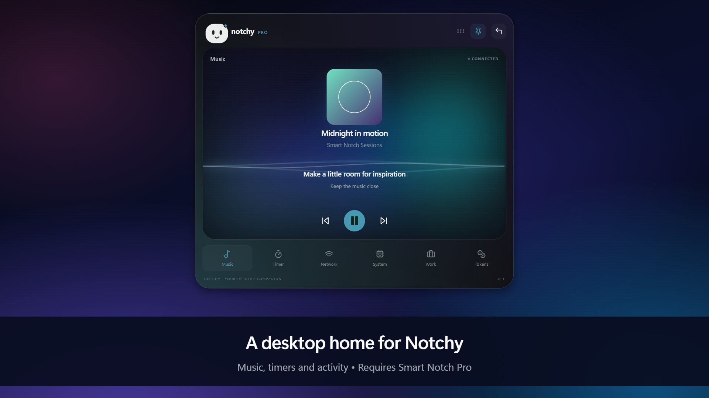

# Smart Notch for Windows

A desktop notch and bar for music, system information and everyday controls.

[Get Smart Notch from Microsoft Store](https://apps.microsoft.com/detail/9N1D46F5X565) · [Report a problem](https://github.com/Avenger11764/Smart-notch/issues/new/choose) · [Release notes](CHANGELOG.md)

This is the public product and support repository. The application source is maintained privately. You do not need GitHub or developer tools to install the app.

## Free and Pro

Free includes the basic dashboard, media controls, system/network indicators, focus tools and copied-text history with Copy.

Smart Notch Pro provides a one-time upgrade for:

- Notchy: supported agent notifications, activity, approvals, account usage and the detachable desktop screen.
- Quick Apps for launching your favorite apps.
- Drop Shelf for temporary drag-and-drop file access.
- Clipboard Pro: pins, images and smart actions.
- Fullscreen music and expanded media features.
- Custom notch length, thickness and placement along supported screen edges.
- Additional Pro controls described in the app's Buy Pro page.

Version 7.1.9 is now available through Microsoft Store, with the new Pro Invisibility Cloak, a website-matched Midnight Liquid theme, fullscreen music upgrades, a compact dashboard, per-agent Notchy colours, more reliable Bar and Pill modes, dependable Open at sign-in and stability improvements. Availability can vary by device and market. Agent usage requires a supported signed-in account and provider-reported data; an open agent window alone does not guarantee quota access.

## A closer look

[Visit the website](https://smart-notch-windows.vercel.app/) · [Browse all 18 Store screenshots](screenshots/README.md)

Screenshots use sample content. Free and Pro availability is labeled in each image.

## Get help

First update through Microsoft Store → Library. If the issue remains, [open a bug report](https://github.com/Avenger11764/Smart-notch/issues/new/choose) with your app version, Windows version, notch/bar mode, Free/Pro edition and steps to reproduce.

Crop screenshots and remove account details. Never post passwords, tokens, private clipboard contents, payment information or full unreviewed logs.

Feature ideas are welcome through the issue templates. This repository accepts documentation and support contributions, not application source changes.

## Updates

Install and update through Microsoft Store. [CHANGELOG.md](CHANGELOG.md) distinguishes prepared updates from published releases. The update.json file supplies published version metadata to the app; it contains no application source. If an older build still reports that it is up to date, open the Store listing and check for updates there.

## Privacy

Read the [Smart Notch Privacy Policy](PRIVACY.md) for local storage, online features and your controls.
