# Smart Notch screenshots

Store artwork captured with sample content for version 7.1.2. These illustrate features; they are not live account data or performance benchmarks.

### Your day, at a glance

Music, devices and system activity • Included free

### A place for everyday controls

Keep useful tools close • Included free

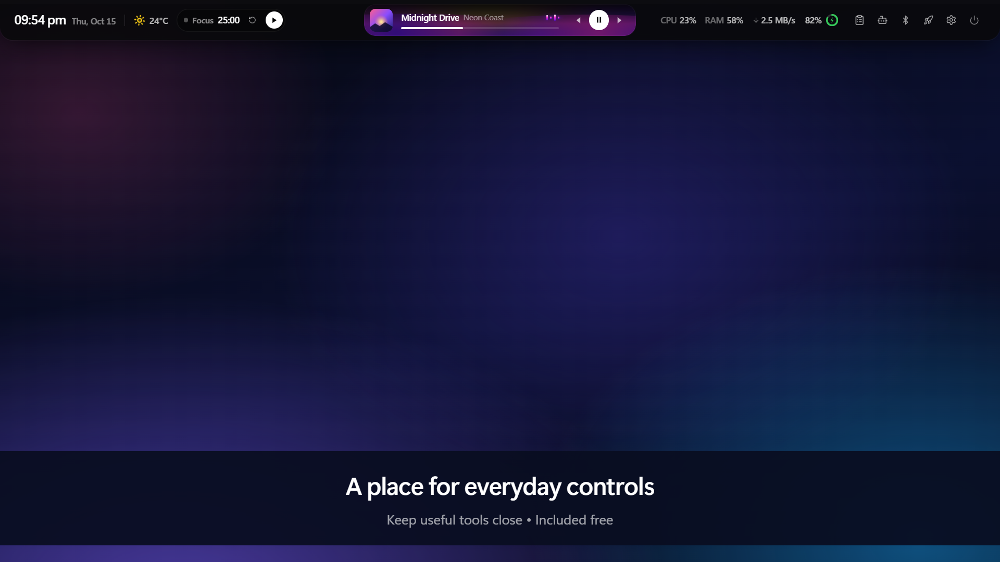

### Keep your music close

Now-playing information and playback controls • Included free

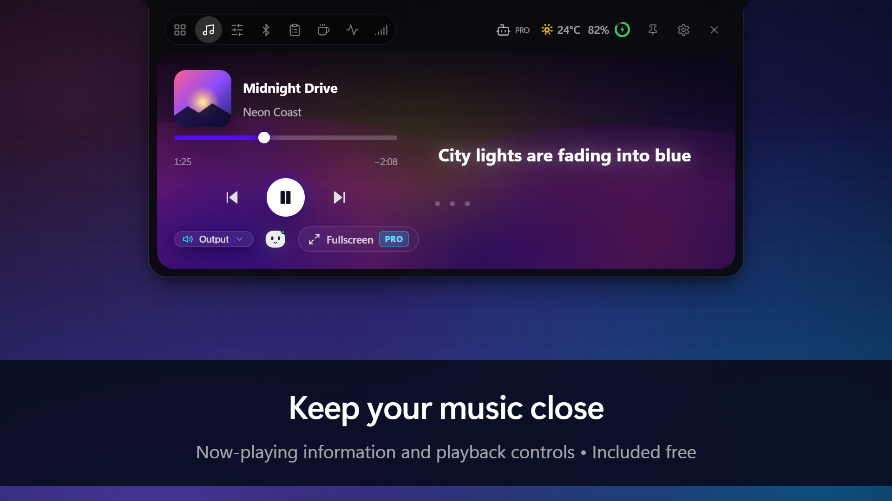

### See how your PC is doing

CPU and memory activity at a glance • Included free

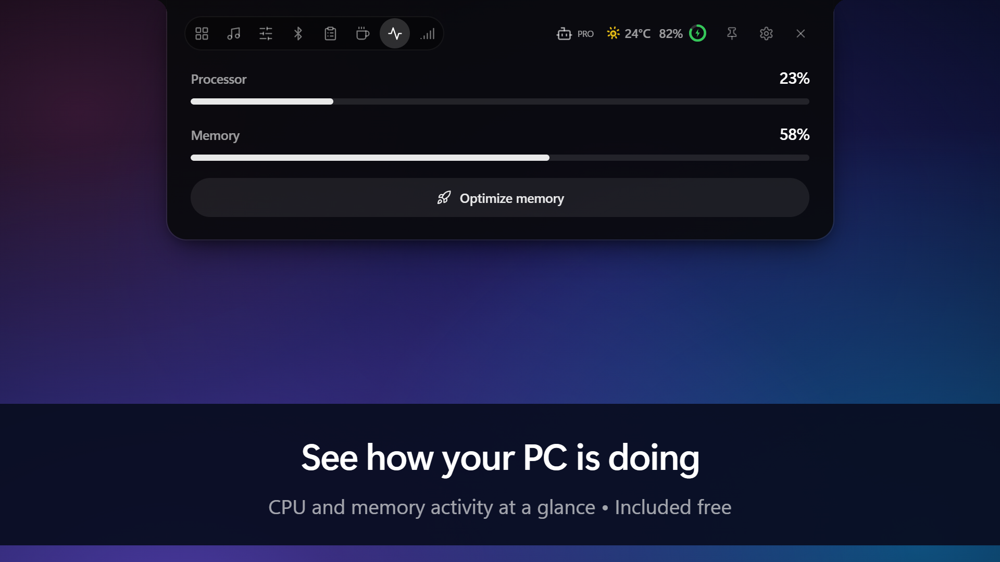

### Your devices, within reach

Controls and battery information for supported Bluetooth devices • Included free

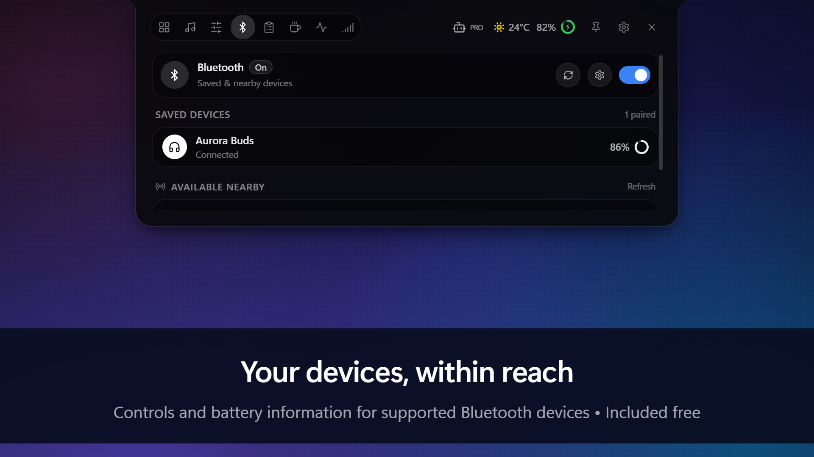

### Copy it again in a click

Your recently copied text, ready to reuse • Included free

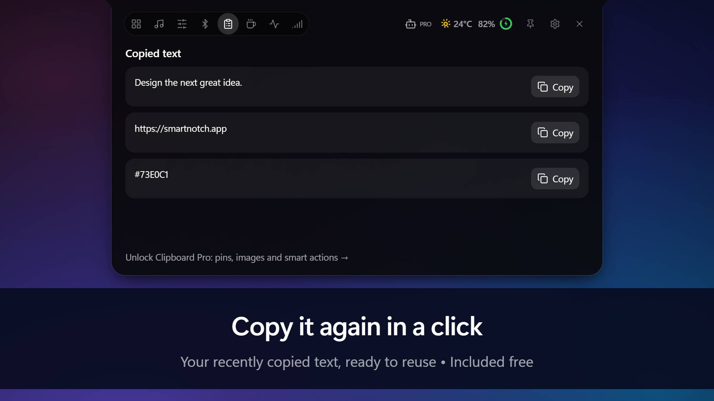

### Make time to focus

A focus timer for your next task • Included free

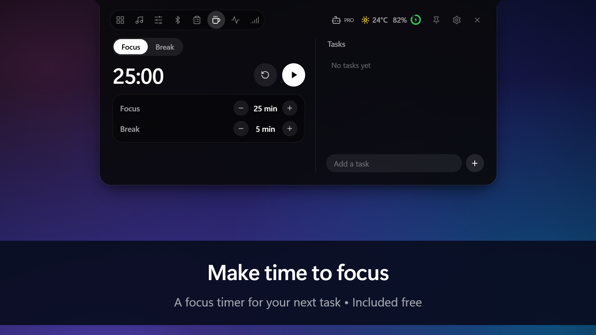

### Stay in step with your agents

Supported agent activity and completion notifications • Requires Smart Notch Pro

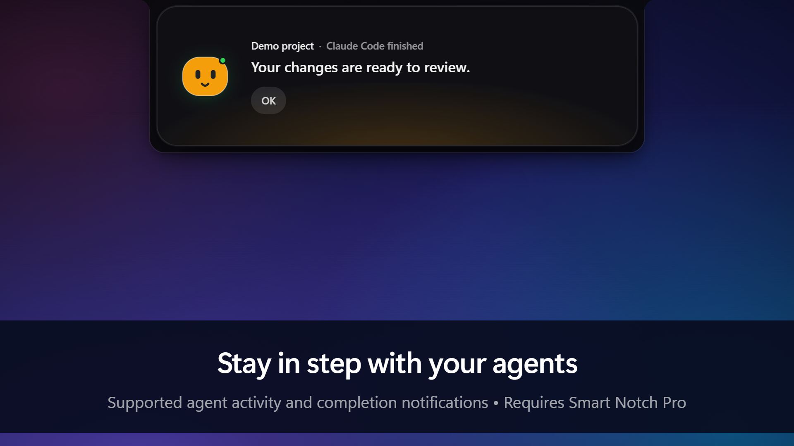

### A desktop home for Notchy

Music, timers and activity • Requires Smart Notch Pro

### Give your music the screen

Fullscreen listening with animated visuals • Requires Smart Notch Pro

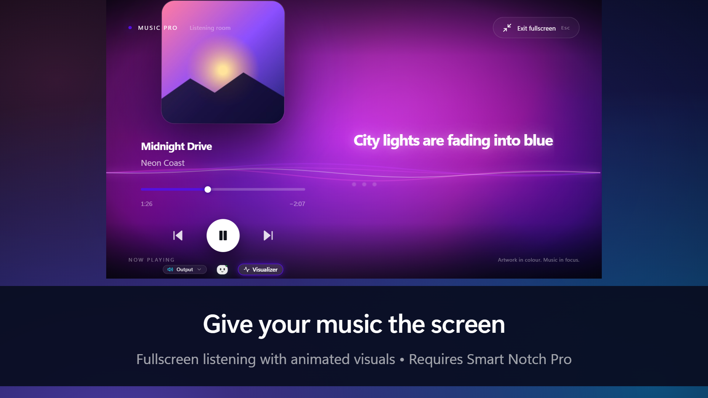

### Set files down. Pick them up later.

A temporary home for files you are working with • Requires Smart Notch Pro

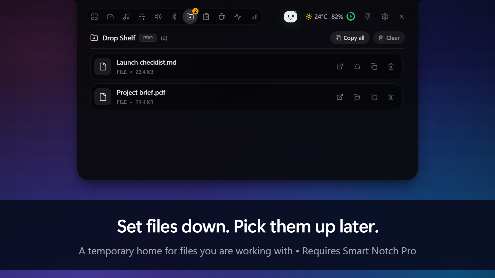

### Keep the useful bits

Pinned snippets and smart clipboard actions • Requires Smart Notch Pro

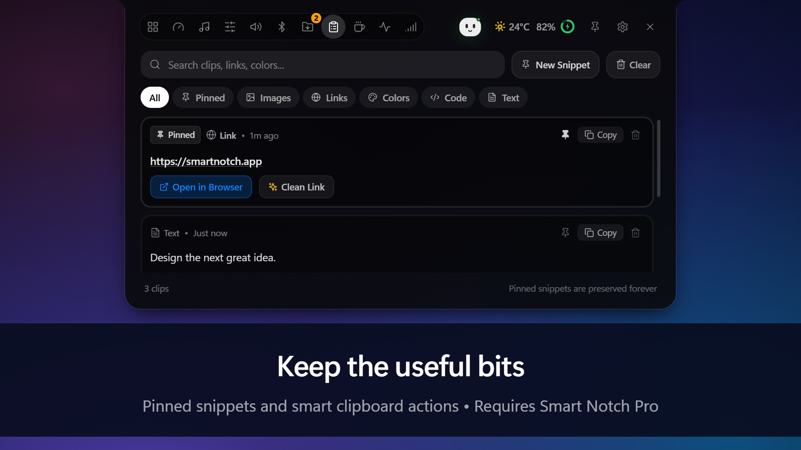

### Your favorites, one click away

Customizable shortcuts for apps, websites and folders • Requires Smart Notch Pro

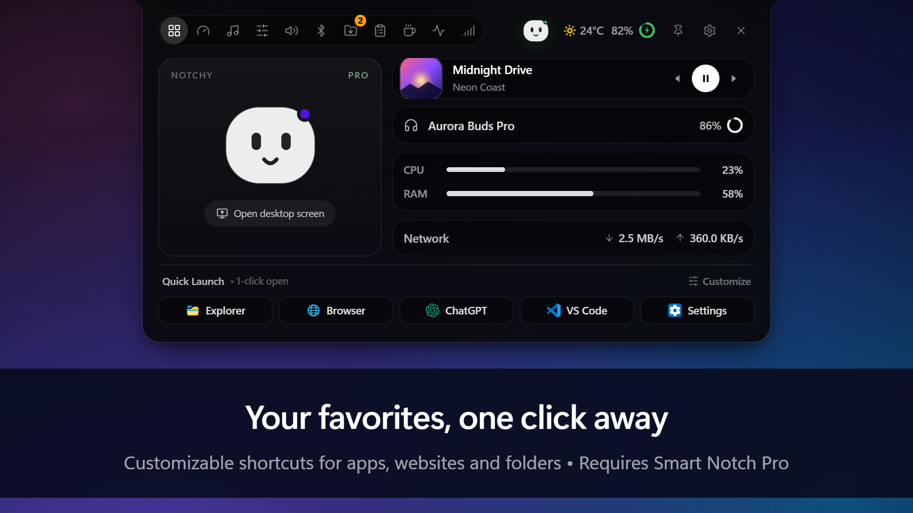

### Find your balance

Control the volume of individual apps • Requires Smart Notch Pro

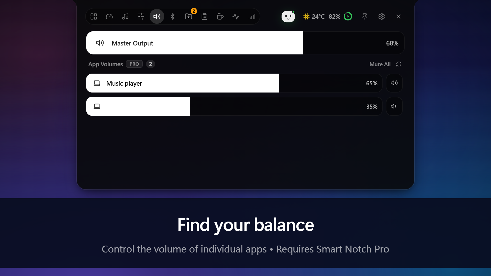

### Keep an eye on downloads

Download activity stays visible alongside your controls • Requires Smart Notch Pro

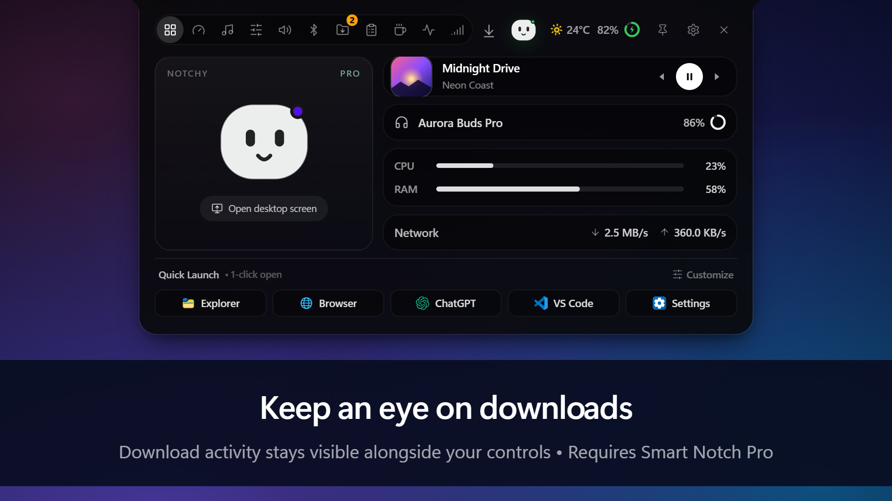

### Make room for your preferences

Independent notch length and thickness • Requires Smart Notch Pro

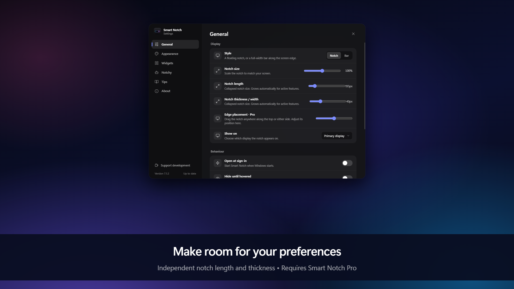

### Find your favorite spot

Position the notch along supported edges and corners • Requires Smart Notch Pro

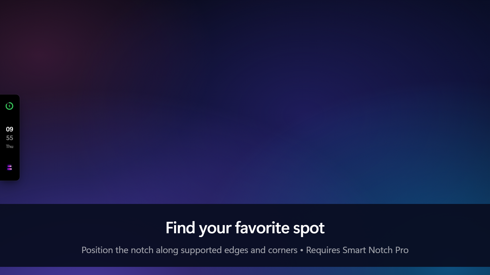

### A little more personality

Premium animated appearance effects • Requires Smart Notch Pro

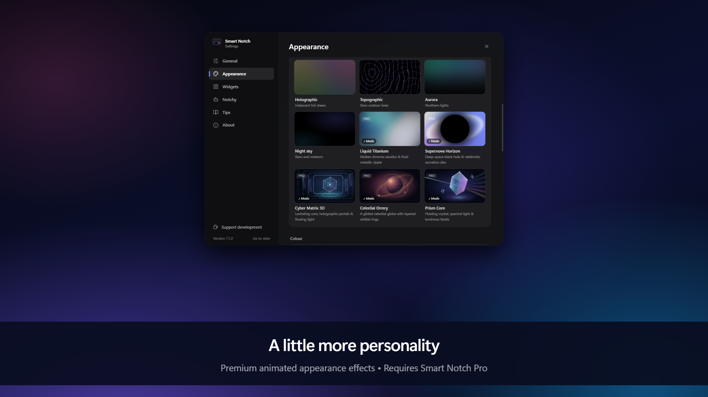
